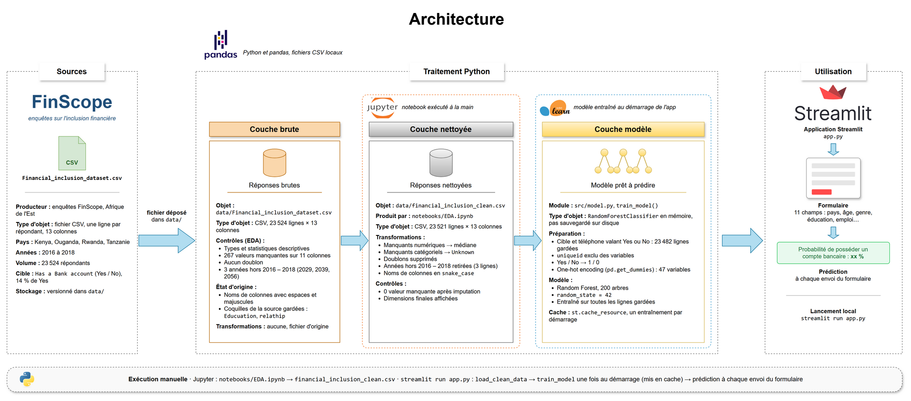
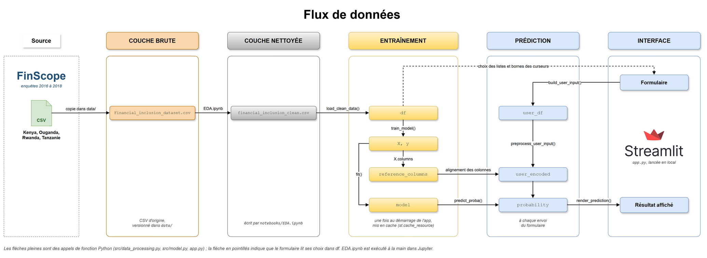

# Application de Prédiction d'Inclusion Bancaire
Bienvenue dans le dépôt de l'**Application de Prédiction d'Inclusion Bancaire** ! 🚀  
Ce projet présente une application interactive de machine learning permettant de prédire la probabilité qu'un individu possède un compte bancaire, à partir de ses caractéristiques socio-démographiques. Conçu comme projet de portfolio, il met en avant les bonnes pratiques en data engineering et développement Python : pipeline de données structuré, clean code, séparation des responsabilités et documentation complète.

## 🌍 Contexte

Les données proviennent des enquêtes **FinScope** menées en **Afrique de l'Est** (Kenya, Rwanda, Tanzanie, Ouganda). L'inclusion bancaire y reste un enjeu majeur : une large partie de la population n'a pas accès aux services financiers formels. Ce projet modélise les facteurs socio-démographiques qui influencent la possession d'un compte bancaire.

---

## 🚀 Exigences du projet

### Pipeline de données (Data Engineering)

#### Objectif
Construire un pipeline structuré de bout en bout : ingestion des données brutes, analyse exploratoire, nettoyage, et mise à disposition pour la modélisation.

#### Spécifications
- **Source de données** : Dataset CSV brut issu des enquêtes FinScope (`Financial_inclusion_dataset.csv`).
- **Analyse exploratoire** : Profilage des données, détection des valeurs manquantes et des doublons, analyse des distributions — documentée dans `notebooks/EDA.ipynb`.
- **Qualité des données** : Pays manquant déduit de l'année d'enquête (une seule année par pays, confirmée par l'identifiant), traitement des valeurs manquantes (médiane pour le numérique, `Unknown` pour le catégoriel), suppression des doublons, retrait des années hors période d'enquête (2016 à 2018), normalisation des noms de colonnes en `snake_case`, libellés ville / campagne de la Tanzanie remis à l'endroit (source : rapport FinScope Tanzania 2017).
- **Output** : Dataset nettoyé exporté vers `data/financial_inclusion_clean.csv`.
- **Documentation** : Convention de nommage disponible dans `docs/convention_de_nommage.md`.

---

### Modélisation & Interface (Machine Learning + Streamlit)

#### Objectif
Entraîner un modèle de classification et le rendre accessible via une interface interactive permettant une prédiction en temps réel.

#### Fonctionnalités
- **Modèle** : Classifieur Random Forest (200 estimateurs) entraîné sur les données nettoyées, **une fois** : `python -m src.model` l'enregistre dans `models/model.joblib`, que l'application charge au démarrage au lieu de le réentraîner ; il n'est réentraîné que si le CSV a changé.
- **Évaluation** : sur un jeu de test stratifié de 20 % mis de côté, mesures publiées dans [`models/metrics.json`](models/metrics.json).
- **Contrôles qualité** : les corrections du nettoyage sont des contrôles automatiques (`src/quality_checks.py`), relancés avant l'export du notebook et avant chaque entraînement ; un défaut qui revient arrête l'exécution.
- **Variables** : Pays et année d'enquête (déduite du pays dans le formulaire), âge, genre, localisation, niveau d'éducation, type d'emploi, situation matrimoniale, taille du foyer, accès téléphonique.
- **Interface** : Formulaire interactif avec sliders, selectbox et labels traduits en français.
- **Résultat** : Probabilité de possession d'un compte bancaire affichée en temps réel.

Pour plus de détails sur les dépendances, consultez [requirements.txt](requirements.txt).

#### Performances

Mesurées par `python -m src.model` sur 4 697 réponses mises de côté, dont 662 avec un compte :

| Mesure | Valeur | Lecture |
|---|---|---|
| Précision globale | 86,7 % | Trompeuse seule : répondre toujours « pas de compte » donne déjà 85,9 % |
| Rappel sur « oui » | 39,7 % | Part des personnes avec un compte que le modèle retrouve |
| Précision sur « oui » | 53,6 % | Part des « oui » prédits qui sont justes |
| AUC | 0,815 | Capacité à classer une personne avec compte au-dessus d'une personne sans |

#### Contrôles qualité

`python -m src.quality_checks` vérifie le dataset nettoyé et sort en erreur si un contrôle échoue :

| Contrôle | Défaut qu'il empêche de revenir |
|---|---|
| Aucune valeur manquante | Imputation sans effet (`fillna(inplace=True)` sur une copie, sous pandas 3) |
| Années d'enquête de 2016 à 2018 | Années saisies hors période (2029, 2039, 2056) |
| Une seule année d'enquête par pays | Couples pays-année incohérents |
| Aucun pays inconnu | Pays manquant non rattaché |
| Cible connue (Yes ou No) | Lignes sans réponse sur le compte |
| Aucun doublon | Lignes en double |
| Niveaux d'éducation nommés | Modalité sans libellé (« 6 ») |
| Urbains plus souvent titulaires d'un compte | Libellés ville / campagne inversés (Tanzanie) |

L'entraînement vérifie en plus que l'identifiant `uniqueid` ne fait pas partie des variables.

---

## ⚠️ Limites des données

Les quatre enquêtes ne sont pas harmonisées. Le nettoyage ne corrige que ce qu'une règle vérifiable ou une source permet de corriger ; le reste est documenté dans les sections 7 et 8 du notebook, sans modifier les données.

| Constat | Détail | Traitement |
|---|---|---|
| Un pays, une année | Rwanda 2016, Tanzanie 2017, Kenya et Ouganda 2018 : l'effet du pays et celui de l'année ne se séparent pas | L'application déduit l'année du pays au lieu de la demander |
| Pays manquant | 14 lignes de 2017 sans pays. Seule la Tanzanie a été enquêtée en 2017, et leurs identifiants (3398 à 3406, 3510 à 3514) comblent exactement des trous de la numérotation tanzanienne | Rattachées à la Tanzanie |
| Types d'emploi codés différemment | Ni agriculture ni emploi public en Tanzanie et en Ouganda, « sans revenu » seulement chez eux, pas d'emploi informel en Ouganda | Aucun : les types d'emploi ne se comparent qu'à l'intérieur d'un pays |
| Ville et campagne inversées en Tanzanie | Le fichier d'origine donne 72,7 % d'urbains, contre 14 à 42 % ailleurs, et ces « urbains » ont moins souvent un compte (4,8 % contre 20,7 %), un téléphone (52 % contre 79 %) et au moins le secondaire (13 % contre 36 %) que les « ruraux » : l'inverse des autres pays. Le rapport officiel de l'enquête donne 34 % d'urbains et 66 % de ruraux ([FinScope Tanzania 2017](https://www.fsdt.or.tz/wp-content/uploads/2017/09/FinScope-Tanzania-2017-Insights-that-Drive-Innovation.pdf), p. 14) | **Corrigé** : « Urban » et « Rural » échangés pour les 6 605 lignes tanzaniennes concernées. Après correction, 27,3 % d'urbains, et dans les quatre pays les urbains ont plus souvent un compte, un téléphone et au moins le secondaire (vérifié par assertion) |
| Cible inconnue | 36 lignes sans réponse sur la possession d'un compte | Retirées : elles ne servent ni à entraîner ni à évaluer le modèle |
| Niveau d'éducation « 6 » | 27 lignes, une modalité sans libellé et sans documentation | Traitée comme inconnue (« Unknown ») |
| Taille du foyer en Tanzanie | 82,8 % des foyers comptent 0 à 2 personnes, contre 16 à 31 % ailleurs, et les 36 foyers de taille 0 sont tous tanzaniens | Aucun : la notion de foyer n'est sans doute pas la même |

---

## 🏗️ Architecture



## 🔀 Flux de données



Les sources éditables sont dans `docs/architecture.drawio` et `docs/flux_de_donnees.drawio` (à ouvrir avec [draw.io](https://www.drawio.com/)).

---

## 🗂️ Structure du projet

```
inclusion_financiere/
│
├── app.py                          # Point d'entrée — streamlit run app.py
│
├── src/
│   ├── data_processing.py          # Chargement et prétraitement des données
│   ├── quality_checks.py           # Contrôles qualité du dataset nettoyé
│   └── model.py                    # Évaluation, entraînement et sauvegarde du modèle
│
├── models/
│   ├── metrics.json                # Performances sur le jeu de test (versionné)
│   └── model.joblib                # Modèle entraîné (généré, non versionné)
│
├── data/
│   ├── Financial_inclusion_dataset.csv   # Dataset brut (enquêtes FinScope)
│   └── financial_inclusion_clean.csv     # Dataset nettoyé (généré par l'EDA)
│
├── notebooks/
│   └── EDA.ipynb                   # Analyse exploratoire des données
│
├── docs/
│   ├── architecture.drawio / .png  # Schéma d'architecture
│   ├── flux_de_donnees.drawio / .png  # Schéma du flux de données
│   └── convention_de_nommage.md    # Conventions de nommage du projet
│
├── requirements.txt                # Dépendances du projet
└── README.md                       # Présentation du projet
```

---

## ⚙️ Installation et utilisation

### 1. Cloner le dépôt
```bash
git clone https://github.com/Majin-M/inclusion_financiere.git
cd inclusion_financiere
```

### 2. Installer les dépendances
```bash
pip install -r requirements.txt
```

### 3. Générer le dataset nettoyé
Ouvrir et exécuter `notebooks/EDA.ipynb` dans Jupyter pour produire `data/financial_inclusion_clean.csv`.

### 4. Contrôler, évaluer et entraîner le modèle
```bash
python -m src.model
```
Lance les contrôles qualité, écrit `models/metrics.json`, puis entraîne le modèle et l'enregistre dans `models/model.joblib`.

### 5. Lancer l'application
```bash
streamlit run app.py
```
L'application charge le modèle enregistré. S'il manque, ou s'il a été entraîné sur une autre version du CSV (empreinte SHA-256 enregistrée avec le modèle), elle relance les contrôles qualité, l'entraîne et l'enregistre.

---

## 🛡️ Licence
Ce projet est sous licence [MIT](LICENSE). Vous êtes libre de l'utiliser, le modifier et le partager avec attribution appropriée.

## 👤 À propos de moi
Je suis Steven Mouthoud, Data Engineer passionné par la construction de pipelines de données robustes et le développement d'applications orientées data.
